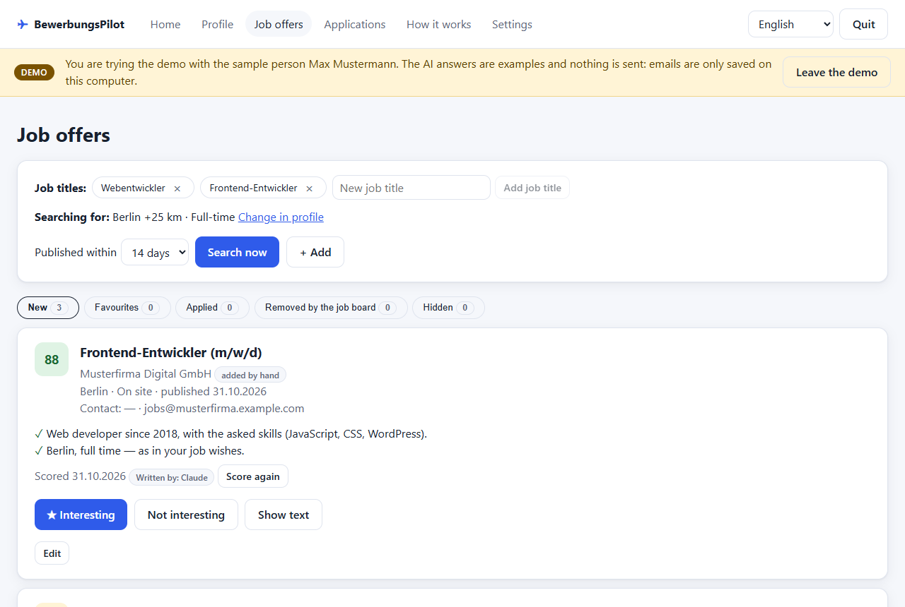
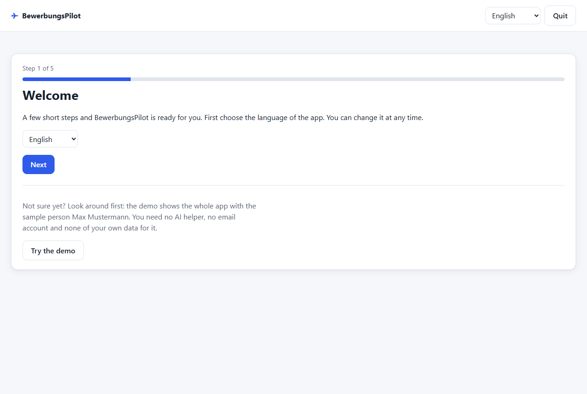
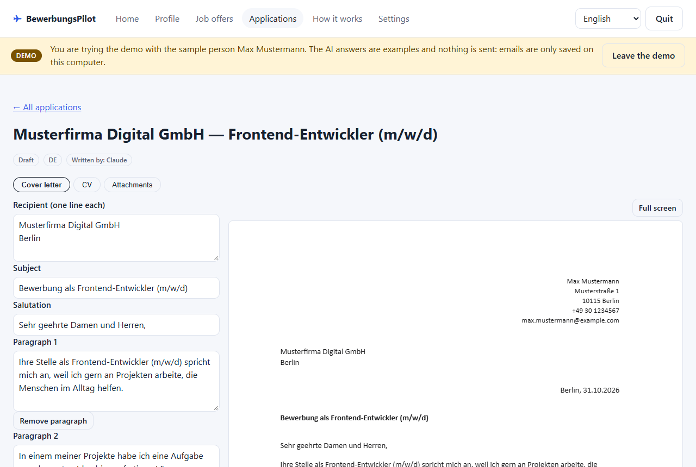
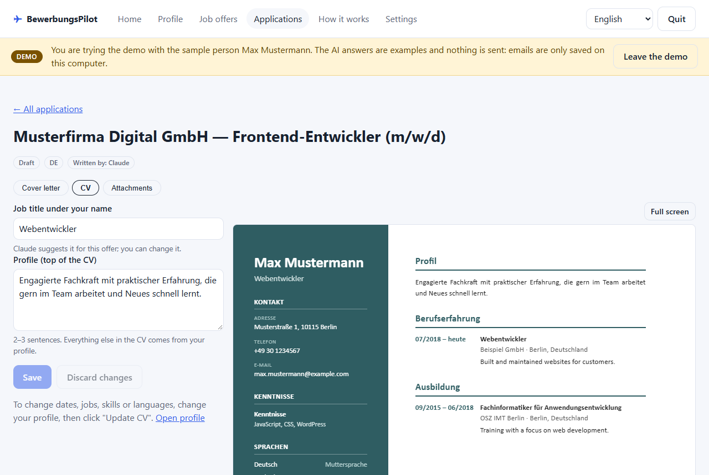
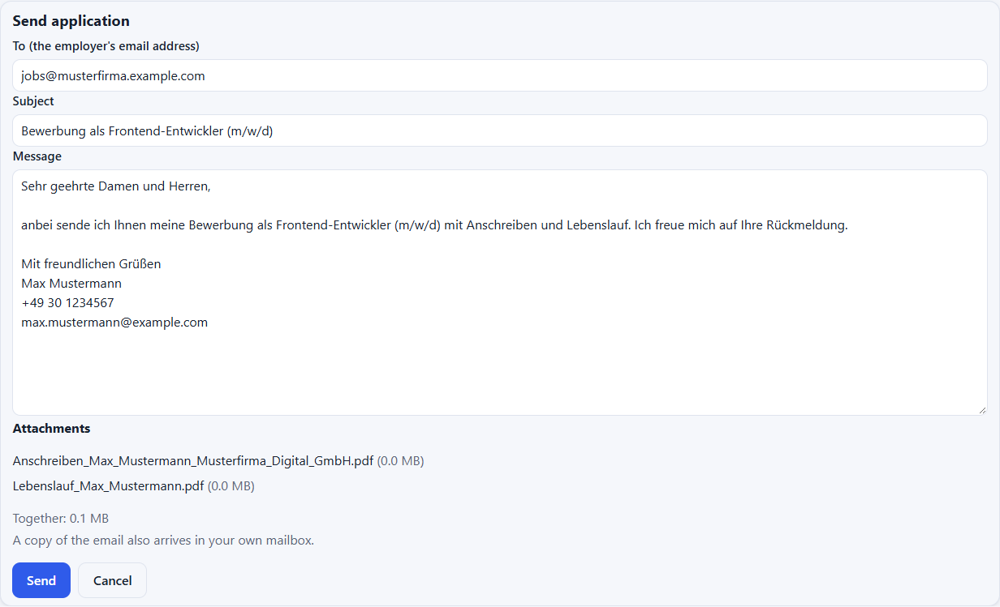
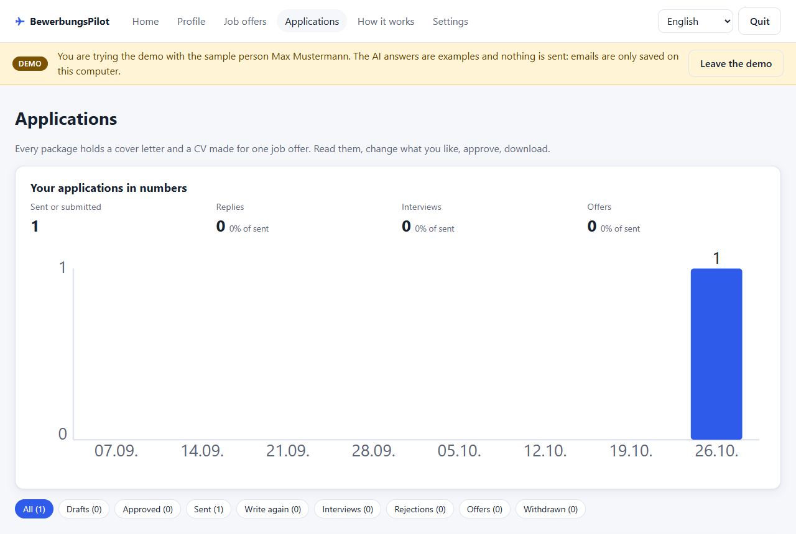

# BewerbungsPilot

A free assistant for job applications in Germany that runs on your own Windows PC. It finds job offers that fit your
profile, writes a cover letter and a tailored CV for each one, sends the applications you approved from your own
email and keeps track of every answer. Nothing is made up: letters are built only from your CV and your own stories.



**Status: v0.10** — profile, job offers, application packages, sending, statuses, reminders, statistics, backups,
update notices and a demo. Six languages: Українська · English · Deutsch · Русский · Polski · Română.

## Start in 5 steps

1. **Download** `BewerbungsPilot-vX.Y.Z.zip` under **Assets** on the [Releases page](https://github.com/RobiKovach/bewerbungs-pilot/releases/latest)
   (not the green **Code** button and not "Source code" — that is the source, not the app) and unzip it.
2. **Install:** double-click `install.bat` and answer its questions. If Windows says "Windows protected your PC", click
   **More info → Run anyway** ([why](#warnings-you-may-see)).
3. **Open** the app with the **BewerbungsPilot** shortcut on your desktop. It opens in your browser.
4. **Try the demo** (optional): one click shows the whole app with the sample person Max Mustermann — no AI helper,
   no mailbox, none of your data. Without that click the app starts empty, for your own profile; the button stays in
   the top bar after setup too.
5. **Set it up for yourself:** choose your AI helper, upload your CV, check your profile and connect your mailbox.
   The app walks you through every step.



## What you need

| | |
|---|---|
| **Computer** | Windows 10 or 11. Node.js 22.12+ — the installer sets it up for you, no administrator rights needed. |
| **AI helper** (writes and scores) | **Claude** with a paid plan ([prices](https://claude.com/pricing)), or **ChatGPT** — a free account works, but its limit is small: one application package takes about 1–3 requests. You connect it inside the app. |
| **Mailbox** (optional) | Gmail ("Sign in with Google") or GMX, WEB.DE, T-Online, Yahoo, iCloud and others with an app password. Without one, download the PDFs and send them yourself. |
| **Browser for PDFs** | Microsoft Edge (part of Windows) or Google Chrome. |

The demo needs none of these except Windows.

## Warnings you may see

Both warnings are normal for a free app from a single developer; neither means something is wrong.

- **Windows SmartScreen** — "Windows protected your PC" when you start `install.bat`. Click **More info → Run anyway**.
  *Why:* the installer is not signed with a paid code-signing certificate yet, so Windows does not know the publisher.
  The installer is a plain script you can read in [`installer/`](installer/); the code is public and checked
  automatically on GitHub.
- **Google** — "Google hasn't verified this app" when you connect a Gmail address. Click **Advanced → Go to
  BewerbungsPilot (unsafe)**. *Why:* Google has not finished checking the app. It only asks for permission to
  **send** the emails you approve — it can never read your mailbox ([what it asks for and why](https://robikovach.github.io/bewerbungs-pilot/#google)).
  Until Google verifies it, at most 100 people in total can sign in this way; if it stops working for you, use another
  mailbox (for example GMX or WEB.DE) or send the PDFs yourself.

## Screens

| | |
|---|---|
|  |  |
| A one-page cover letter for one offer; edit it or ask the AI helper to change it. | A CV tailored to the offer, in German or English. |
|  |  |
| You see and can change every email before it goes out from your own mailbox. | Statuses, reminders and statistics of every application. |

## Updating and your data

Your data stays on your PC in `%LOCALAPPDATA%\BewerbungsPilot`. Updating = run the new
installer; your data is kept. Before an update the installer saves a backup of your data to the backup folder
(`Documents\BewerbungsPilot\Backups`, or `%USERPROFILE%\BewerbungsPilot\Backups` when Documents is synced with OneDrive,
or the folder you chose in Settings → Backups) and keeps the three newest of its own backups (your manual backups are
never deleted). What changed in each version: [CHANGELOG.md](CHANGELOG.md).

## AI helper

In the first steps you choose who does the writing: **Claude** or **ChatGPT**. The app installs the helper for you and
walks you through signing in; you can switch at any time in Settings. Only one helper works at a time.

- Limits depend on your plan. With a free ChatGPT account the limit is small: one application package takes about 1–3
  requests, a job search up to about 5. When the limit is reached the app says so and stops; try again later or switch helper.
- Privacy: your CV and answers are sent to the helper's provider. On personal ChatGPT plans (free and paid), turn off
  "Improve the model for everyone" in ChatGPT Settings → Data controls so your texts are not used for training; this also
  covers Codex. See <https://help.openai.com/en/articles/7730893-data-controls-in-chatgpt>.
- What the install buttons run: **Install Claude** runs Anthropic's official installer
  (`irm https://claude.ai/install.ps1 | iex`); **ChatGPT** installs the `@openai/codex` package from npm at a pinned
  version.

## Security

- Every start of the app creates a new launch key. Only the shortcut opens the app with it; a bookmark or a typed
  address shows "Open BewerbungsPilot with its shortcut" instead. The key stops other Windows users on this PC, and
  websites or programs that cannot read your files, from reading your data through the app. A program running under
  your own Windows account can read the key file, see the next point.
- It does not protect against an administrator of the PC or malware running under your own Windows account. If you
  moved your data folder with `BP_DATA_DIR`, it is only as private as that folder's permissions.
- Close the app before installing an older version: installers before 0.8.3 may not stop the running app.
- The installer is not signed yet, so Windows SmartScreen may warn you: see [Warnings you may see](#warnings-you-may-see).
- The new-version notice only ever links to this repository's Releases page; any other link in the version file is
  ignored, so a broken website cannot send you to a foreign download.
- Found a security problem? Please report it privately — see [SECURITY.md](SECURITY.md).

## Privacy

The developer receives none of your data. Apart from the daily version check below, the app talks only to the services
you use through it (job board, AI helper, email provider) — details in the [privacy policy](https://robikovach.github.io/bewerbungs-pilot/privacy.html).

Once a day the app asks the BewerbungsPilot website (GitHub Pages) whether a newer version exists. GitHub sees your IP
address, as with any website; nothing about you or your data is sent. You can switch it off in **Settings → Updates**.

## Languages

German, Russian, Polish and Romanian are machine-translated — corrections are welcome.

## Your profile

The profile is the basis of every application. Upload your CV (PDF or Word) or fill in the same sections yourself.
The AI helper reads the CV and fills in personal details, education, work experience, skills and languages; every field it
filled is marked **"AI – please check"** until you save or confirm it. Then the AI helper asks 3–7 short personal questions
and turns your answers into a *story bank* — true, concrete stories that cover letters are later built from (a cover
letter should tell what you did, not repeat your CV). You can add a CV photo (cropped to 3:4) and PDF documents to attach.

- Everything stays on your computer: `%LOCALAPPDATA%\BewerbungsPilot\profile\`.
- The AI helper never gets access to your folders: Claude reads a copy of your CV in a throw-away folder, ChatGPT gets only its text.
- Nothing is made up: the AI helper may only use what your CV and your answers say.
- Applications can only be written once every section is checked ("All correct").

## Job offers

BewerbungsPilot searches the job board of the Federal Employment Agency (Bundesagentur für Arbeit) for your job titles,
cities and search radius from your profile ("Job wishes"). Offers you have already seen, and formats you did not ask for
(internships, apprenticeships, student jobs), are left out without asking the AI helper. The AI helper then scores every new offer
from 0 to 100 and says in two or three points why it fits and what is missing.

- "★ Interesting" keeps an offer in your favourites; "Not interesting" hides it for good (you can bring it back).
- Offers the job board has removed move to "Removed by the job board" by themselves.
- Add or remove job titles right above the search button; they are saved to your job wishes. Few results? Add more
  job titles (e.g. "Softwareentwickler" next to "Frontend Entwickler") or choose a longer "Published within" period.
- The points are written in the app's language at the moment of scoring. After switching the language, the card says
  so; "Score again" writes them in the new language.
- Found an offer somewhere else? Paste its text — or just its link — with "+ Add"; the AI helper reads it and scores it
  the same way. Some sites (e.g. StepStone, Indeed, LinkedIn) do not let the app read the page; then paste the text.
  Behind a company or system proxy, reading links may fail for every site (the proxy address looks internal, so it
  is blocked); then paste the text as well.
- Offers you applied to (package sent, or marked "submitted on the website") move to their own **Applied** tab
  with the date; open the package from there or hide the offer. Offers you added yourself are never shown as a weak
  match and come first in **New**.
- Up to 50 new offers per search; the search runs in the background and can be stopped at any time.
- Stored on your computer: `%LOCALAPPDATA%\BewerbungsPilot\vacancies\`. The job search only talks to
  `rest.arbeitsagentur.de`. A pasted link (not Arbeitsagentur) is opened only when you give no text, in a separate
  browser profile, and never to an internal address such as your router or this PC.

## Application packages

- Mark a job offer as **Interesting**, then click **Create package** on its card. Choose German or English for the
  documents (the language of the offer is suggested).
- You need a checked profile (personal details, education, experience, skills, languages) and at least one checked
  story that may be told to employers.
- The AI helper writes the cover letter from your stories — one or two true stories tied to what the offer asks for, never a
  list of skills from your CV — and tailors the CV: descriptions translated into the document language, the skills
  that matter first, a short Profile at the top. Nothing is made up; your "never mention" list is respected.
- The CV shows a round photo (crop it in a circle in your profile), a job title chosen for each offer (you can edit
  it), up to 3 links from your profile, and skills in groups. Education entries of type course or certificate get
  their own "Further training & certificates" section.
- Countries and language names are translated into the document language.
- Edit every part of the letter yourself or ask the AI helper to change it. The letter must fit on one page before you can
  approve the package. Any change after approving makes it a draft again.
- Download the letter, the CV and your attachments one by one, or everything as one PDF. PDFs are made with
  Microsoft Edge or Google Chrome installed on your computer.

## Email and sending

- Connect your mailbox in Settings and send a test email. Gmail addresses use "Sign in with Google"; Google still shows
  a warning for it — see [Warnings you may see](#warnings-you-may-see). The app only asks to *send* email, never to read
  it (see the [privacy policy](https://robikovach.github.io/bewerbungs-pilot/privacy.html)).
  For other providers you use an app password (a separate password for apps): GMX, WEB.DE, T-Online, Yahoo and iCloud are filled in
  automatically; others (e.g. Outlook.com) are entered by hand.
- Send an approved package from the app: you see and can edit the email first, and a copy goes to your own mailbox.
- Applied on a company website instead? Mark the application as submitted.
- Track the status and history of every application (sent, interview, rejected, offer, withdrawn) on the Applications page.
  A package that was sent can no longer be changed.

## Development

```
npm ci
npm run dev -w server     # API on http://127.0.0.1:4280 (add -- --fake-llm to avoid real AI helper calls)
npm run dev -w web        # dashboard on http://localhost:5173
npm test && npm run i18n:check
npm run release           # builds release/BewerbungsPilot-v<version>.zip
node scripts/screenshots.mjs en docs/images   # after npm run build: the README screenshots, taken from the demo
```

In development open the dashboard on port 5173: take the `http://127.0.0.1:4280/open?key=…` address the server prints
and open it as `http://localhost:5173/open?key=…` (the dev server passes it on). The launch key changes every time the
server restarts (also on a file change), so open the new address after a restart.

Test modes (command line or environment only — never from the app's settings):

- `--demo` / `BP_DEMO=1` — the demo copy that «Try the demo» starts: both modes below, on `<data folder>/demo`, seeded
  once with Max Mustermann (`server/src/demo/demo.ts`). `BP_DEMO_LANGUAGE` sets its language.
- `--fake-llm` / `BP_FAKE_LLM=1` — every AI task gets a scripted answer (`server/src/llm/fake-scripted.ts`): a fictional
  CV (Max Mustermann), questions, stories, vacancy scores, a cover letter and CV parts that pass the app's checks.
- `--fake-mail` / `BP_FAKE_MAIL=1` — nothing is sent: every mail (also the test mail when a mailbox is saved, SMTP or
  Google) is written to `<data folder>/tmp/fake-mail/<time>-<n>.json` with attachment names and sizes. "Sign in with
  Google" and disconnecting still talk to Google for real — only sending is faked.
- `BP_DATA_DIR`, `BP_BACKUP_DIR`, `BP_UPDATE_URL` point the data, the backups and the update check somewhere else.

The server log and the console say "FAKE MODE" when one of them is on.

## License

[PolyForm Noncommercial 1.0.0](LICENSE) — free for personal and other noncommercial use;
commercial use is not permitted.
